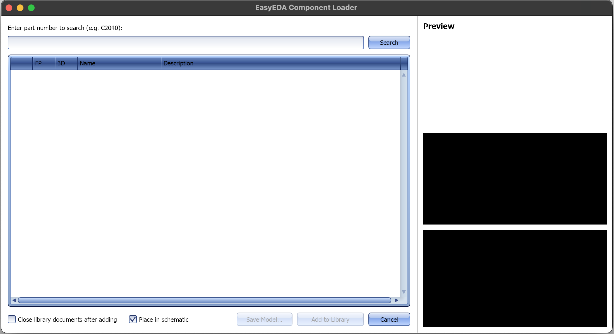

# EasyEDALoader for Altium

## Install

1. Close Altium Designer.
2. Download and run **EasyEDALoader-Setup-1.3.0.exe** from the [latest release](https://github.com/lazy-jubei/EasyEDALoader/releases/latest). The installer uses .NET Framework 4.8.
3. Select your Altium Designer 17 or 26 installation, install the plugin, then reopen Altium.

For macOS or Linux with Wine, download the ZIP for your Altium version, extract it, and run `python3 tools/deploy-wine.py --altium-version 17` or `--altium-version 26` from the extracted directory. The ZIP also includes `Deploy.ps1` for manual Windows installation.

EasyEDALoader imports EasyEDA/LCSC symbols, footprints, and 3D models into Altium Designer. It is a fork of [expired6978/EasyEDALoader](https://github.com/expired6978/EasyEDALoader).

[](https://sonarcloud.io/summary/new_code?id=lazy-jubei_EasyEDALoader)

## Usage

1. Open **EasyEDA Loader**, search for an LCSC part such as `C2040`, and tick the parts you want.
2. Choose an **Output directory**. The default is `Documents/AltiumEE`.
3. Choose **Add to Library**. Each component gets its own folder with a linked schematic symbol and PCB footprint.

```text
AltiumEE/
└── RP2040-easy/
    ├── RP2040-C2040.SchLib
    └── RP2040-C2040.PcbLib
```

The folder uses the part name with an `-easy` suffix. If parts share a name, the additional folder includes its LCSC number. The loader reuses an existing complete pair when you import the same part again. Parts without a symbol or footprint are skipped with an error. The PCB library embeds the STEP model when EasyEDA provides one and it imports successfully.

With **Place in schematic** enabled, the loader places the last successfully imported component in the active schematic. Clear the option to export the libraries by themselves. Set `EASYEDA_LIBRARY_DIR` to provide the initial output directory for the current process.

## Build

Install .NET SDK 8 or newer and the matching Altium Designer installation. The AD26 release build uses Altium SDK assemblies from a .NET 8-based AD26 installation. The SDK and DevExpress assemblies come from the Altium installation.

On Windows, run the following in PowerShell. Use `-AltiumVersion 17` for the AD17 build and package steps.

```powershell
.\Build.ps1 -AltiumInstallDir 'C:\Program Files\Altium\AD26'
.\Package.ps1
```

After building and packaging both AD17 and AD26, create the Windows installer with:

```powershell
.\installer\Build-Installer.ps1
```

For macOS with Wine and PowerShell 7, run `./tools/build-macos.sh` and `pwsh -NoProfile -File Package.ps1`. Set `ALTIUM_VERSION=17` and pass `-AltiumVersion 17` to the packaging script for AD17. Set `ALTIUM_INSTALL_DIR` if Altium lives outside the default Wine prefix.

Pass `-IncludeStandalone` to both `Build.ps1` and `Package.ps1` to include the optional standalone AD26 preview app.

Build and test details are in the [AD26](AD26.md) and [AD17](AD17.md) notes.

## Screenshots

[](Assets/EasyEDA-Loader-Window.png)

RP2040 import examples show EasyEDA on the left and Altium on the right.

| Schematic symbol | PCB footprint | 3D model |
| --- | --- | --- |
| [](Assets/Compare-Symbol.png) | [](Assets/Compare-Footprint.png) | [](Assets/Compare-3D.png) |

Conversion references come from [easyeda2kicad.py](https://github.com/uPesy/easyeda2kicad.py).
